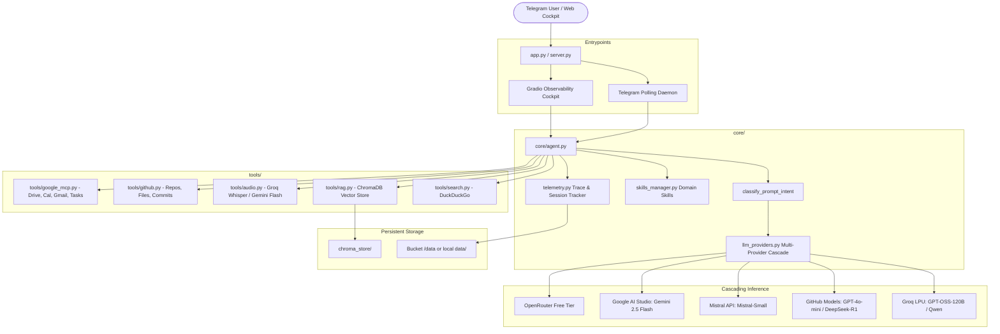

# ☤ TashuBot Architecture & System Design

TashuBot is an autonomous 24/7 AI agent with multi-provider failover, dynamic tool calling (DuckDuckGo Search, ChromaDB RAG, Google Workspace MCP, GitHub API, Audio/Voice STT), session memory compaction, and live telemetry observability.

---

## 🏗️ System Overview

---

## 📁 Repository Layout

| Directory / File | Description |
| :--- | :--- |
| `app.py` | Main entry point for Hugging Face Spaces (Gradio Cockpit + Telegram Daemon) |
| `server.py` | Standalone CLI entry point for running only the Telegram polling bot |
| `requirements.txt` | Python package dependencies for local run and cloud deployment |
| `.env.example` | Comprehensive reference for all API keys, tokens, and configuration secrets |
| `core/` | Core agent engine and orchestration logic |
| `core/agent.py` | Autonomous multi-hop reasoning and function calling loop |
| `core/llm_providers.py` | Intent-aware routing and resilient multi-provider LLM cascade |
| `core/skills_manager.py` | Dynamic domain skill discovery, YAML frontmatter parser, and prompt injector |
| `core/telemetry.py` | Thread-safe trace logging, KPI metrics aggregation, and session storage |
| `tools/` | Specialized tool integrations invoked by the agent |
| `tools/search.py` | Live web search via DuckDuckGo (`ddgs`) |
| `tools/rag.py` | ChromaDB vector store query engine for personal documents |
| `tools/audio.py` | Speech-to-text transcription (Groq Whisper Large v3 / Gemini Flash) |
| `tools/github.py` | GitHub repository search, profile inspection, and file content reading |
| `tools/google_mcp.py` | Google OAuth2 token refresher and Google Apps (Drive, Calendar, Gmail, Tasks) APIs |
| `skills/` | Specialized domain skills containing instructions and behavioral guidelines |
| `scripts/` | Maintenance, setup, and indexing scripts |
| `scripts/setup_google_mcp.py` | Interactive local OAuth setup flow to generate Google refresh tokens |
| `scripts/rag_index.py` | Document chunker and vector indexer for ChromaDB |
| `documents/` | Storage folder for personal documents (`.txt`, `.md`) to be indexed |
| `docs/` | Architecture guides and historical build documentation |
| `tests/` | Automated unit test suite verifying imports, schemas, skills, and telemetry |

---

## ⚡ Multi-Provider LLM Cascade

TashuBot classifies incoming user prompts into four distinct intents before routing:

1. **`coding`**: Programming, debugging, algorithms, syntax.
   - Priority: GitHub Models (`gpt-4o-mini`) ➔ Groq (`openai/gpt-oss-120b`) ➔ Gemini 2.5 Flash
2. **`creative`**: Brainstorming, drafting, writing, humor.
   - Priority: Mistral (`mistral-small-latest`) ➔ Groq ➔ Gemini 2.5 Flash
3. **`fast_chat`**: Greetings, rapid queries, simple lookups.
   - Priority: Groq LPU (`openai/gpt-oss-120b`) ➔ OpenRouter ➔ Gemini 2.5 Flash
4. **`general`**: Research, complex queries, multi-step tool calls.
   - Priority: Groq ➔ GitHub Models ➔ Mistral ➔ Gemini ➔ OpenRouter

---

## 🛠️ Dynamic Multi-Hop Tool Execution

1. Agent receives user message and conversation history.
2. Injects system prompt, live UTC timestamp, loaded domain skills, and available tools.
3. Queries orchestrated model with function schemas.
4. If model returns `tool_calls`:
   - Executes requested tool(s) concurrently or sequentially.
   - Appends tool output to message chain.
   - Re-queries LLM with observation results.
   - Loops up to 6 iterations until final answer is synthesized.
5. Telemetry records trace ID, tools utilized, latency, provider chosen, and context pruning events.
